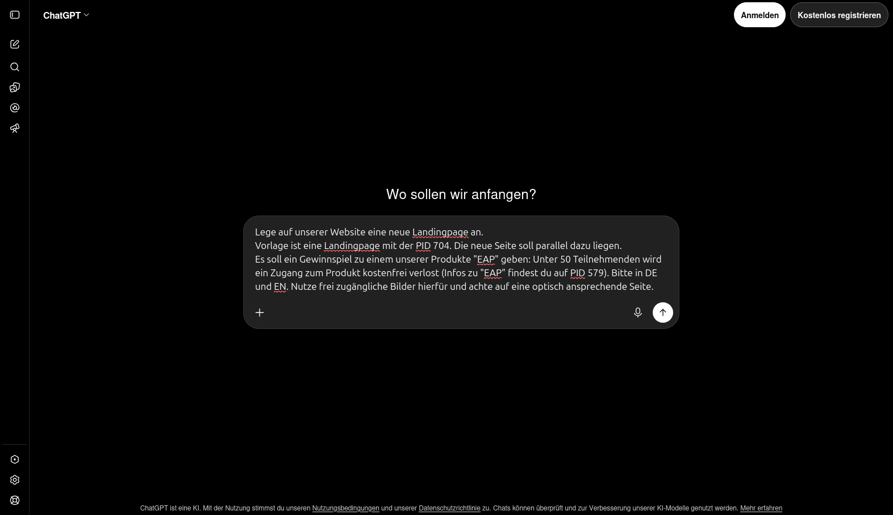
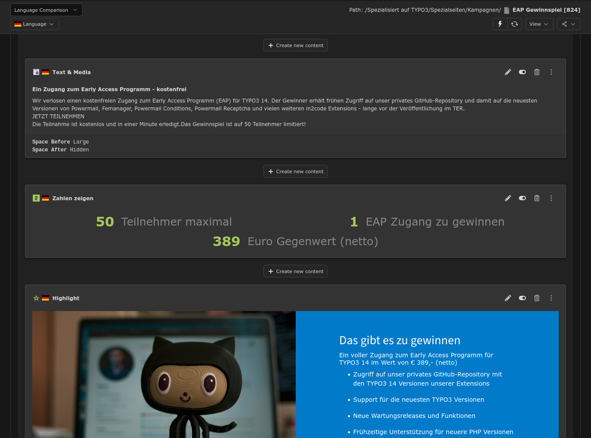
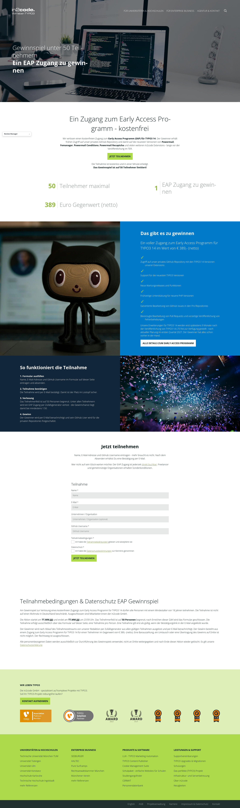

# in2mcp - MCP Server for TYPO3

Turns a TYPO3 installation into a **Model Context Protocol (MCP) server**, so that MCP clients like
Claude (Desktop, Web, Code), Gemini or ChatGPT can connect to the CMS and work on it - reading the page tree,
inspecting existing content and creating or editing records within the permissions of the connected
backend user.

Example usage from ChatGPT in Browser to create a new page in your TYPO3:


Content elements created from AI in TYPO3 backend:


Ready created frontend without the need of a backend login:


## Table of Contents

- [Introduction](#introduction)
- [Requirements](#requirements)
- [Installation](#installation)
- [Quick start](#quick-start)
- [Tools](#tools)
- [Permissions](#permissions)
- [Contribution with DDEV](#contribution-with-ddev)
- [Changelog](#changelog)
- [Breaking Changes](#breaking-changes)

## Introduction

MCP knows three roles: a **host** (the chat application), a **client** (the connector inside the host)
and a **server** (the system that offers the capabilities). in2mcp is the **server** part: TYPO3
exposes `tools`, `resources` and `prompts`, the LLM decides when to call them.

## Quick start

```bash
# 1. activate the server in the extension configuration (setting "mcpServer")
#    the endpoint is /typo3/mcp and can be renamed with the setting "mcpServerPath"
#    "mcpServerAllowedIps" restricts the client addresses, [BE][IPmaskList] applies as well
# 2. an editor needs a group with the custom module option "Use MCP clients",
#    administrators always may
# 3a. OAuth: switch on the setting "oauth" and add the url to the client without any header,
#     the user logs into the backend in the browser and confirms the access
claude mcp add --transport http in2mcp https://your-domain.org/typo3/mcp
# 3b. or an api key, for scripts and clients without a browser - switch on the setting "apiKeyAuthentication" first
vendor/bin/typo3 in2mcp:apikey <uid|username>
claude mcp add --transport http in2mcp https://your-domain.org/typo3/mcp --header "Api-Key: <key>"
```

For claude.ai, ChatGPT and Gemini Enterprise use OAuth: add a custom connector with the URL, every user connects
with their own backend login. ChatGPT and Gemini Enterprise cannot send an api key at all, and a connector shared
in a claude.ai organization would otherwise run every member as the user of one key. Gemini Enterprise needs a
client that an administrator creates in the backend. See [Documentation/McpServer.md](Documentation/McpServer.md)
for every client and the full reference.

## Tools

Every tool runs with the permissions of the connected backend user. An OAuth connection with read access only
offers the reading tools alone.

### Reading

| Tool                           | Description                                                                                       |
|--------------------------------|---------------------------------------------------------------------------------------------------|
| `get_backend_user`             | The backend user of this connection with its permissions, plus context, server url and sites       |
| `get_page_tree`                | The page tree as a nested structure, only pages the user may see                                  |
| `get_page`                     | A single page with its fields, content elements by column, page translation and translation mode  |
| `search_pages`                 | Search pages by title, navigation title, subtitle or slug                                         |
| `resolve_url`                  | Site, language, redirect and page behind a frontend url, and why a visitor gets no page           |
| `get_schema`                   | Page types, content types and fields, allowed values of select fields per page and record type    |
| `get_record`                   | A single record of any table                                                                      |
| `find_records`                 | Search records of a table by page, field values (also empty ones) and language                    |
| `find_references`              | Records that point to a record (relations, translations, links in texts), from the reference index |
| `search_files`                 | Search existing files by name, path or title, also files with empty metadata                      |
| `get_recently_changed_pages`   | Pages changed most recently - page properties, translations or content                            |
| `get_recently_changed_content` | Content elements changed most recently, with title and slug of their page                         |
| `get_workspaces`               | Live and every workspace the user may work in, the current one marked                             |

### Administrators only

| Tool                 | Description                                                                                  |
|----------------------|----------------------------------------------------------------------------------------------|
| `get_backend_users`  | Backend users with last login, active MFA providers and their last change                     |
| `get_recent_changes` | Newest entries of the record history: who changed which record when (field names, no values) |

### Writing

| Tool                     | Description                                                                                                 |
|--------------------------|-------------------------------------------------------------------------------------------------------------|
| `create_page`            | Create a page below a parent page, the slug is generated by TYPO3                                           |
| `update_page`            | Change fields of a page, all other fields stay untouched                                                    |
| `create_content_element` | Create a content element on a page, also inside a container element                                         |
| `update_content_element` | Change fields of a content element                                                                          |
| `create_record`          | Create a record of any other table the user may write, for example a form or a news entry                   |
| `update_record`          | Change fields of a record of any other table                                                                |
| `add_child_record`       | Create a record inside an inline field of a parent, for example a page of a form                            |
| `localize_record`        | Translate a page, content element or record, connected ("Translate") or free ("Copy") like the backend       |
| `move_record`            | Move a record into a page or behind another record, also into another column or container                   |
| `sort_content_elements`  | Put the content elements of one column into a given order in one call                                       |
| `delete_record`          | Delete a record of any table (restorable in the recycler), a page with its subpages and content             |
| `add_file_from_url`      | Download a file from a public url into the file storage - **off by default** (setting `fileImport`)         |
| `add_file_from_content`  | Store a small file passed as base64 - **off by default** (setting `fileUpload`)                             |
| `create_file_upload`     | One-time upload url for a local file of any size, for clients with a shell - **off by default** (`fileUpload`) |
| `add_file_reference`     | Connect an existing file to a file field, with title, alternative text, caption or link in the same call    |
| `delete_file`            | Delete a file through the file storage, only one that no record uses anymore                                |
| `clear_cache`            | Clear the cache of all pages, of a single page or everything                                                |
| `switch_workspace`       | Change the workspace all following reads and changes happen in                                              |

`add_file_from_url` is off by default because it makes the server perform an outgoing request that a client
decides on - only public addresses are accepted, optionally restricted to a list of hosts.

## Permissions

in2mcp has no permission concept of its own. The OAuth token or the api key identifies a TYPO3 backend user, that
user is initialized like in a regular backend request, and everything afterwards runs through the regular TYPO3
checks:
page permissions and page mounts when reading, the **DataHandler** when writing. So an MCP client can do exactly
what that backend user can do in the backend - and nothing beyond it, or less: an OAuth connection can be limited
to reading on the consent page. Emptying the api key, deleting the OAuth connection in the backend user record or
disabling the user revokes the access immediately.

Concretely: page mounts and page permissions when reading pages and records, the **DataHandler** when writing,
the **file mounts** when searching or attaching files, and the page mounts again when clearing the cache of a
single page. Raw HTML stays raw for a user who may use the `html` content element and is sanitized for everybody
else, because that is what TYPO3 does with a backend save.

There is one deliberate exception: tables that hold authentication data, internal bookkeeping or scheduled
commands (`be_users`, `fe_users`, `sys_log`, `tx_scheduler_task` and their relatives) are refused for every user,
administrators included, and storages, file mounts, workspaces and TypoScript are read only, so an api key that
leaked cannot create a backend user, widen permissions or schedule a command. See
`TableAccessService::DENIED_TABLES` and `READ_ONLY_TABLES`.

Further tables - for example with personal data - are denied with the setting `deniedTables` (or the environment
variable `IN2MCP_DENIED_TABLES` while the setting is empty), `tx_powermail_domain_model_*` denies every table that
starts with it. The setting is empty by default. The built-in lists themselves can be changed in code with the PSR-14
event `ModifyTableAccessEvent`.

An api key has the form `<uid>.<secret>` and only the secret is stored, hashed. OAuth uses the authorization code
flow with PKCE, the login on the consent page includes multi factor authentication, and tokens are stored as hash
only. Failing authentications are rate limited per ip address. Multi factor authentication is skipped for an api
key, so an installation that enforces MFA should hand out api keys accordingly or allow OAuth only
(`apiKeyAuthentication = 0`). See [Documentation/McpServer.md](Documentation/McpServer.md)
for the full picture.

## Requirements

- TYPO3 13.4 LTS or 14.x
- PHP 8.2 or higher

## Installation

### With composer

```
composer require in2code/in2mcp
```

### With extension manager

Search for `in2mcp` in the TYPO3 extension manager and install it.

## Contribution with DDEV

This repository ships a ready to use DDEV environment including a small TYPO3 test instance
(database dump and fileadmin files).

```bash
ddev start
ddev initialize
```

`ddev initialize` links the TYPO3 configuration from `.ddev/TYPO3/` into `config/`, imports the
database dump from `.ddev/data/db.sql.gz`, extracts the fileadmin archive, runs `composer install`
and copies the default `.htaccess`.

- Frontend: https://in2mcp.ddev.site
- Backend: https://in2mcp.ddev.site/typo3 (admin / admin)

### Notes on `ddev start`

- `additional.php already exists and is managed by the user.` is expected. `config/system/additional.php`
  is a symlink to `.ddev/TYPO3/additional.php` and therefore not DDEV managed - exactly what we want.
- `.ddev/web-build/Dockerfile` forces git to HTTP/1.1 inside the web container. Without it, git 2.39.5
  fails on GitHub's HTTP/2 ref listing (`could not read Username` / `expected flush after ref listing`),
  which breaks `install_nvm.sh` on every container start and any git based composer repository.

Useful commands:

```bash
ddev composer install                       # install dependencies
ddev exec .Build/bin/typo3 cache:flush      # flush all caches
ddev mysql                                  # database shell
ddev createdumpfile                         # update .ddev/data/db.sql.gz from current database
ddev createfilesarchive                     # update .ddev/data/fileadmin.tar.gz from current files
ddev composer test:php:lint                 # lint all php files
ddev composer test:php:cs                   # check the code style with PHP CS Fixer
ddev composer test:unit                     # run the unit tests
ddev composer test:functional               # run the functional tests (all four also run in GitHub Actions)
```

## Changelog

| Version | Date       | Status  | Description |
|---------|------------|---------|-------------|
| 8.0.0   | 2026-11-25 | Feature | New tools find_references (records that point to a record, from the reference index) and sort_content_elements (order of a column in one call). find_records pages with offset and nextOffset, matches a list of values and a part of a field ({"contains": ...}). returnFields and contentFields reduce returned records to some fields. get_page adds the page translation and the translation mode of a language and explains a deleted page. get_backend_user describes the system (application context, server url, sites with languages). localize_record translates in free mode. Single FlexForm fields can be changed. Fixes: inline fields of pages and content elements as uid lists like in every other tool, get_workspaces without EXT:workspaces lists live, a list as filter value is no internal error any more, a password field can not be used as filter. |
| 7.0.0   | 2026-11-24 | Feature | New setting deniedTables (or environment variable IN2MCP_DENIED_TABLES) to deny further tables for every user, for example tables with personal data, with a trailing * as prefix. New PSR-14 event ModifyTableAccessEvent to change the built-in denied and read only tables in code. get_recent_changes leaves out the history of denied tables. Tool list of the readme as tables, status column in the changelog |
| 6.0.2   | 2026-11-23 | Bugfix  | Dynamic client registration gives a client secret to clients that ask for one (claude.ai could not connect without a client created in the backend), PKCE stays mandatory for them. Refused registrations are logged |
| 6.0.1   | 2026-11-23 | Bugfix  | Fix the installation of tailor in the TER release workflow |
| 6.0.0 !!! | 2026-11-23 | Feature | OAuth 2.1 as second way to connect besides the api key: consent page with backend login and MFA, dynamic client registration, client id metadata documents, clients with secret for Gemini Enterprise, read only or read and write access, connections listed and revocable in the backend user record, rate limited OAuth endpoints, cleanup command in2mcp:oauth:cleanup. Extension configuration grouped in the tabs Connections and File. Breaking: api keys are off by default (setting apiKeyAuthentication) |
| 5.0.0 !!! | 2026-11-18 | Feature | New tools get_workspaces, switch_workspace, add_file_from_content and create_file_upload with an upload endpoint, find records with empty fields and files with empty metadata, restrict the client addresses (mcpServerAllowedIps), MCP for editors per backend group, tool annotations (read only, destructive, open world), functional tests and PHP CS Fixer. Fixes: accept clients of the MCP revision 2026-07-28, refuse content types the backend groups do not allow, refuse files the file field does not accept, store children of a page on the page itself, refuse fields of a translation TYPO3 would not write, no warning for the navigation title in get_recently_changed_pages. Security Hardening |
| 4.1.0   | 2026-11-12 | Feature | get_recently_changed_pages and get_recently_changed_content name the last editor (changedBy) for administrators |
| 4.0.0   | 2026-11-12 | Feature | New tools get_recently_changed_pages and get_recently_changed_content, new administrator tools get_backend_users and get_recent_changes |
| 3.0.1   | 2026-11-11 | Bugfix  | Allow mcp/sdk 0.9 again, so the extension can be installed on TYPO3 13 (remove SdkCompatibility with TYPO3 13 support)             |
| 3.0.0   | 2026-11-11 | Feature | New tool delete_file, added unit tests, small security improvent for importing images: refuse IPv6 addresses carrying an internal IPv4 in add_file_from_url                   |
| 2.4.1   | 2026-11-11 | Task    | Security: update mcp/sdk to 0.10 (PKSA-s52d-n7sx-trsg), bind MCP sessions to the backend user                                      |
| 2.4.0   | 2026-10-20 | Feature | Allowed values of select fields in get_schema (per page and record type), set fields of a new file reference in add_file_reference |
| 2.3.0   | 2026-10-20 | Feature | Report allowed content elements per page in get_schema, some bugfixes to show usefull messages for permission problems             |
| 2.2.0   | 2026-09-04 | Task    | Security: authenticate a request by its api key only, never by a backend session                                                   |
| 2.1.0   | 2026-09-03 | Task    | Update extension icon, use schema API from TYPO3, update documentation                                                             |
| 2.0.0   | 2026-09-02 | Feature | Allow creating of any records, adjust endpoint, allow inserting images, security reviews                                           |
| 1.0.0   | 2026-09-02 | Feature | Initial extension release                                                                                                          |

## Breaking Changes

### 6.0.0

- **Api keys are off by default.** The new setting `apiKeyAuthentication` (tab "Connections" of the extension
  configuration) is `0` by default, and TYPO3 writes this default into the configuration with the update. Every
  api key is refused afterwards, without being deleted. An installation that keeps connecting with api keys has to
  switch the setting on after the update; one that moves to OAuth switches on `oauth` instead.

### 5.0.0

- **Editors need a backend group option.** An api key alone is not enough anymore: an editor may use MCP only if
  one of their backend groups has the option *MCP server (in2mcp) > Use MCP clients with an api key* in "Custom
  module options" (`custom_options` `in2mcp:access`). Administrators always may. Without it, every request of an
  editor is answered with 401.
